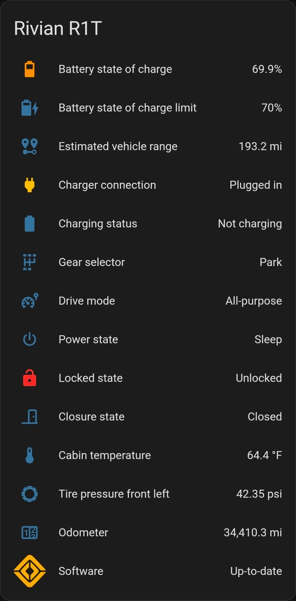

# Home Assistant integration for Rivian (Unofficial)

[![GitHub Release][releases-shield]][releases]
![GitHub all releases][download-all]
![GitHub release (latest by SemVer)][download-latest]
[![GitHub Activity][commits-shield]][commits]

An unofficial Rivian integration for Home Assistant, installed through [HACS](https://hacs.xyz/docs/setup/download).

To use this extension, you'll need the following information

- Rivian Username
- Rivian Password
- Rivian Account's MFA/OTP Device (optional, depending on your Rivian account settings)

Your vehicle must be in delivered status and possession for this integration to function.

# Disclaimer

This [Home Assistant](https://www.home-assistant.io/) integration is not affiliated, associated, nor sponsored by Rivian Automotive, Inc.

Any use of this integration is at the sole discretion and risk of the Rivian vehicle owner integrating it into their Home Assistant installation. This owner takes full responsibility for protecting their local Home Assistant installation.

This integration is provided out of love and passion towards the Rivian ownership community. It focuses on building insights and awareness into the state of one's vehicle for use by the owner and the owner alone.

This integration will not share user or vehicle data outside Home Assistant, a single-user environment hosted and running within an owner's private network and hardware systems.

## Installation

1. Use [HACS](https://hacs.xyz/docs/setup/download). In HACS add a custom repository by going to `HACS > Integrations > 3 dots > custom repositories` and adding this github repo `https://github.com/bretterer/home-assistant-rivian`. Now skip to 7.
2. If no HACS, use the tool of choice to open the directory (folder) for your Home Assistant configuration (where you find `configuration.yaml`).
3. If you do not have a `custom_components` directory (folder) there, you need to create it.
4. In the `custom_components` directory (folder) create a new folder called `rivian`.
5. Download _all_ the files from the `custom_components/rivian/` directory (folder) in this repository.
6. Place the files you downloaded in the new directory (folder) you created.
7. Restart Home Assistant.
8. [![Add Integration][add-integration-badge]][add-integration] or in the Home Assistant UI go to "Configuration" -> "Integrations" click "+" and search for "Rivian (Unofficial)".

## Configuration

To connect your newly installed integration to pull available sensor data (see the below example) for your Rivian vehicle, you should follow the following configuration recommendations. Not doing so could put your main Rivian account at risk of being locked and available.

- One Time Password (**recommended**) - It is best security practice always to enable One Time Password / Multi-Factor Authentication. This way, your credentials (username + password) can not be used without your explicit consent through the personal device configured on your Rivian account.
- No Account Reuse* (**recommended**) - Another best security practice is not to reuse accounts or credentials across different integrations (e.g., sharing credentials between Home Assistant and your everyday account). We highly recommend the owner *invite a new driver\*, for example, `user+<purpose>@domain.com`, and use only this profile for configuration within Home Assistant. **Note:** Sensors will not be displayed for this new driver until the driver is signed in to a Rivian phone app and linked to the vehicle like an actual new driver. You may temporarily sign out of your Rivian phone app to set up this driver profile: Profile icon (bottom nav bar) > "Manage account" > Sign out (top right corner).

The configuration flow is as follows:

1. **Username and Password (required)**
   - For the integration to work, we require a username and password to a Rivian account with an active _driver profile_ for the vehicle you wish to monitor remotely.
2. **OTP/MFA (optional)**
   - If OTP is enabled on the account provided, you will receive a text from Rivian with a one-time use passcode entered at this step.

\*Developers and Maintainers of this project take no personal responsibility for misconfiguration or misuse of the code provided by this integration. Account security is entirely the sole responsibility of the owner configuring this integration. Accounts may become locked/quarantined due to this unofficial integration.

## Remote Vehicle Control

In addition to viewing vehicle data, it is also possible to issue certain vehicle commands remotely via Home Assistant as you would in the Rivian mobile app.

**Note:** Remote vehicle control isn't supported yet for Gen2 R1T and R1S vehicles (2025 model year and later) or the R2. Their Bluetooth hardware changed, and how they complete the secure pairing process hasn't been figured out yet.

To enable this feature, you need to have:

- Home Assistant instance with a Bluetooth adapter (or [ESP32 Bluetooth proxy](https://esphome.io/projects/?type=bluetooth)) with a minimum Bluetooth version of 4.2
  - The Bluetooth adapter/proxy needs to be within reach of your vehicle's Bluetooth radio to complete the one-time, in-vehicle pairing process
  - After pairing, Bluetooth is no longer required as commands are sent remotely via the Rivian cloud
- Two-factor authentication (2FA) enabled on your Rivian account
- An available slot for a phone key (currently limited to 4 per vehicle as of vehicle software 2023.26.00)

To complete the pairing setup, configure the integration and select the vehicle(s) for which you want to enable vehicle controls in Home Assistant and then:

1. From within your vehicle, navigate to "Drivers and Keys" under settings
2. Select "Set Up" for the relevant phone key (this should be the name of your Home Assistant instance's home location, typically "Home")
3. Click on the "Pair" button entity for the associated vehicle in Home Assistant
   - Home Assistant will then attempt to connect to your vehicle and complete the pairing process. On Darwin (MacOS) based systems, a pop-up will appear which you will have to manually click to allow pairing. On Linux or Windows systems, this should happen automatically.

Note: If you are having issues with pairing your vehicle, we recommend investing in an ESP32 with Bluetooth proxy installed as it offers flexibility in placement and has been proven to work where other adapters have not.

## Available Sensors

Entities are available for all models (R1T, R1S and R2) unless noted otherwise.

| Name                                                | Domain         | Description                                                                                                                    |
| --------------------------------------------------- | -------------- | ------------------------------------------------------------------------------------------------------------------------------ |
| 12V battery health                                  | Sensor         |                                                                                                                                |
| Active driver                                       | Sensor         | The name of the active driver.                                                                                                 |
| Altitude                                            | Sensor         |                                                                                                                                |
| Amperage                                            | Sensor         | Wallbox current                                                                                                                |
| Amperage maximum                                    | Sensor         | Wallbox maximum current                                                                                                        |
| Battery capacity                                    | Sensor         |                                                                                                                                |
| Battery state of charge                             | Sensor         |                                                                                                                                |
| Battery state of charge limit                       | Sensor         |                                                                                                                                |
| Battery thermal runaway propagation                 | Sensor         |                                                                                                                                |
| Battery thermal status                              | Sensor         |                                                                                                                                |
| Bearing                                             | Sensor         |                                                                                                                                |
| Bluetooth module failure status door front left     | Sensor         |                                                                                                                                |
| Bluetooth module failure status door front right    | Sensor         |                                                                                                                                |
| Bluetooth module failure status fascia front        | Sensor         |                                                                                                                                |
| Bluetooth module failure status fascia rear         | Sensor         |                                                                                                                                |
| Bluetooth module failure status instrument controls | Sensor         |                                                                                                                                |
| Brake fluid level                                   | Sensor         |                                                                                                                                |
| Cabin climate preconditioning                       | Binary sensor  | Running/not running status                                                                                                     |
| Cabin climate preconditioning type                  | Sensor         |                                                                                                                                |
| Cabin temperature                                   | Sensor         |                                                                                                                                |
| Car wash mode                                       | Binary sensor  | On/off status                                                                                                                  |
| Charge port                                         | Binary sensor  | Open/closed status, R1T and R1S only                                                                                           |
| Charge port door next action                        | Sensor         | R1T and R1S only                                                                                                               |
| Charger connection                                  | Binary sensor  | Plugged in/unplugged status                                                                                                    |
| Charger derate status                               | Sensor         |                                                                                                                                |
| Charger state                                       | Sensor         | Detailed charging state: charging, scheduled, complete, waiting on charger, errors, etc.                                       |
| Charging cost                                       | Sensor         | Cost of the current or last charging session                                                                                   |
| Charging energy delivered                           | Sensor         | Energy delivered in the current or last charging session                                                                       |
| Charging fault                                      | Sensor         | Why charging is disabled or reduced, if it is                                                                                  |
| Charging range added                                | Sensor         | Range added in the current or last charging session                                                                            |
| Charging rate                                       | Sensor         | Range added per hour while charging                                                                                            |
| Charging schedule days                              | Sensor         |                                                                                                                                |
| Charging speed                                      | Sensor         | Charging power                                                                                                                 |
| Charging start time                                 | Sensor         | Start of the current or last charging session                                                                                  |
| Charging status                                     | Binary sensor  | Charging/not charging status                                                                                                   |
| Charging status                                     | Sensor         | Wallbox status: available, plugged in, charging, etc.                                                                          |
| Charging time elapsed                               | Sensor         | Time spent actively charging in the current or last session                                                                    |
| Charging time remaining                             | Sensor         |                                                                                                                                |
| Closure state                                       | Binary sensor  | Open/closed status of all closures                                                                                             |
| Cold range notification                             | Sensor         | Whether cold weather is reducing range                                                                                         |
| Defrost/defog                                       | Binary sensor  | Running/not running status                                                                                                     |
| Destination                                         | Sensor         | Final stop of the active navigation trip                                                                                       |
| Destination ETA                                     | Sensor         | Estimated arrival at the destination                                                                                           |
| Door front left                                     | Binary sensor  | Open/closed status                                                                                                             |
| Door front left lock                                | Binary sensor  | Locked/unlocked status                                                                                                         |
| Door front right                                    | Binary sensor  | Open/closed status                                                                                                             |
| Door front right lock                               | Binary sensor  | Locked/unlocked status                                                                                                         |
| Door rear left                                      | Binary sensor  | Open/closed status                                                                                                             |
| Door rear left lock                                 | Binary sensor  | Locked/unlocked status                                                                                                         |
| Door rear right                                     | Binary sensor  | Open/closed status                                                                                                             |
| Door rear right lock                                | Binary sensor  | Locked/unlocked status                                                                                                         |
| Door state                                          | Binary sensor  | Open/closed status of all doors                                                                                                |
| Drive mode                                          | Sensor         |                                                                                                                                |
| Driver temperature                                  | Sensor         |                                                                                                                                |
| Drivers                                             | Sensor         | Number of drivers with access to the vehicle                                                                                   |
| Estimated vehicle range                             | Sensor         |                                                                                                                                |
| Front trunk                                         | Binary sensor  | Open/closed status                                                                                                             |
| Front trunk lock                                    | Binary sensor  | Locked/unlocked status                                                                                                         |
| Front trunk next action                             | Sensor         |                                                                                                                                |
| Gear Guard                                          | Binary sensor  | Locked/unlocked status, R1T and R1S only                                                                                       |
| Gear Guard alarm                                    | Binary sensor  | Tampered/clear status                                                                                                          |
| Gear Guard video mode                               | Sensor         |                                                                                                                                |
| Gear Guard video status                             | Sensor         |                                                                                                                                |
| Gear Guard video terms accepted\*                   | Sensor         |                                                                                                                                |
| Gear selector                                       | Sensor         |                                                                                                                                |
| Gear tunnel left                                    | Binary sensor  | Open/closed status, R1T only                                                                                                   |
| Gear tunnel left lock                               | Binary sensor  | Locked/unlocked status, R1T only                                                                                               |
| Gear tunnel left next action                        | Sensor         | R1T only                                                                                                                       |
| Gear tunnel right                                   | Binary sensor  | Open/closed status, R1T only                                                                                                   |
| Gear tunnel right lock                              | Binary sensor  | Locked/unlocked status, R1T only                                                                                               |
| Gear tunnel right next action                       | Sensor         | R1T only                                                                                                                       |
| Heated seat 3rd row left                            | Binary sensor  | Running/not running status, R1S only                                                                                           |
| Heated seat 3rd row right                           | Binary sensor  | Running/not running status, R1S only                                                                                           |
| Heated seat front left                              | Binary sensor  | Running/not running status                                                                                                     |
| Heated seat front right                             | Binary sensor  | Running/not running status                                                                                                     |
| Heated seat rear left                               | Binary sensor  | Running/not running status                                                                                                     |
| Heated seat rear right                              | Binary sensor  | Running/not running status                                                                                                     |
| Heated steering wheel                               | Binary sensor  | Running/not running status                                                                                                     |
| In use state                                        | Binary sensor  | Moving/stopped status                                                                                                          |
| Keys                                                | Sensor         | Number of phone keys across all drivers                                                                                        |
| Liftgate                                            | Binary sensor  | Open/close status, R1S and R2 only                                                                                             |
| Liftgate lock                                       | Binary sensor  | Locked/unlocked status, R1S and R2 only                                                                                        |
| Liftgate next action                                | Sensor         | R1S and R2 only                                                                                                                |
| Limited acceleration (cold)                         | Sensor         |                                                                                                                                |
| Limited regenerative braking (cold)                 | Sensor         |                                                                                                                                |
| Locked state                                        | Binary sensor  | Locked/unlocked status of all closures                                                                                         |
| Next stop                                           | Sensor         | Next stop of the active navigation trip, including charging stops, past the one the vehicle is at (its `arrived_at` attribute) |
| Next stop ETA                                       | Sensor         | Estimated arrival at the next stop                                                                                             |
| No updates since                                    | Sensor         | When the vehicle last reported data; empty unless that was over 10 minutes ago                                                 |
| Odometer                                            | Sensor         |                                                                                                                                |
| Pet mode                                            | Binary sensor  | Running/not running status                                                                                                     |
| Pet mode temperature status                         | Sensor         |                                                                                                                                |
| Power                                               | Sensor         | Wallbox power                                                                                                                  |
| Power maximum                                       | Sensor         | Wallbox maximum power                                                                                                          |
| Power state                                         | Sensor         |                                                                                                                                |
| Range threshold                                     | Sensor         |                                                                                                                                |
| Rear hitch status                                   | Sensor         | Nothing, an accessory or a trailer on the hitch                                                                                |
| Remote charging available                           | Sensor         |                                                                                                                                |
| Service mode                                        | Sensor         |                                                                                                                                |
| Software                                            | Update         |                                                                                                                                |
| Software OTA - Download progress                    | Sensor         |                                                                                                                                |
| Software OTA - Install duration                     | Sensor         |                                                                                                                                |
| Software OTA - Install ready                        | Sensor         |                                                                                                                                |
| Software OTA - Install time                         | Sensor         |                                                                                                                                |
| Software OTA - Install type                         | Sensor         | R1T and R1S only                                                                                                               |
| Software OTA - Last install result                  | Sensor         |                                                                                                                                |
| Software OTA - Status                               | Sensor         |                                                                                                                                |
| Speed                                               | Sensor         |                                                                                                                                |
| Tailgate                                            | Binary sensor  | Open/close status, R1T only                                                                                                    |
| Tailgate lock                                       | Binary sensor  | Locked/unlocked status, R1T and R1S only                                                                                       |
| Tailgate next action                                | Sensor         | R1T only                                                                                                                       |
| Tire pressure front left                            | Sensor         |                                                                                                                                |
| Tire pressure front left status                     | Sensor         | OK/warning status                                                                                                              |
| Tire pressure front left validity                   | Binary sensor  | OK/problem status                                                                                                              |
| Tire pressure front right                           | Sensor         |                                                                                                                                |
| Tire pressure front right status                    | Sensor         | OK/warning status                                                                                                              |
| Tire pressure front right validity                  | Binary sensor  | OK/problem status                                                                                                              |
| Tire pressure rear left                             | Sensor         |                                                                                                                                |
| Tire pressure rear left status                      | Sensor         | OK/warning status                                                                                                              |
| Tire pressure rear left validity                    | Binary sensor  | OK/problem status                                                                                                              |
| Tire pressure rear right                            | Sensor         |                                                                                                                                |
| Tire pressure rear right status                     | Sensor         | OK/warning status                                                                                                              |
| Tire pressure rear right validity                   | Binary sensor  | OK/problem status                                                                                                              |
| Tonneau                                             | Binary sensor  | Open/close status, R1T with a powered tonneau only                                                                             |
| Tonneau lock                                        | Binary sensor  | Locked/unlocked status, R1T with a powered tonneau only                                                                        |
| Trailer status                                      | Sensor         |                                                                                                                                |
| _Vehicle name_                                      | Device tracker | Vehicle location, named after the vehicle itself                                                                               |
| Vehicle updates                                     | Binary sensor  | OK/problem status: a problem when nothing has arrived from Rivian for 10 minutes                                               |
| Vented seat front left                              | Binary sensor  | Running/not running status                                                                                                     |
| Vented seat front right                             | Binary sensor  | Running/not running status                                                                                                     |
| Voltage                                             | Sensor         | Wallbox voltage                                                                                                                |
| Voltage maximum                                     | Sensor         | Wallbox maximum voltage                                                                                                        |
| Window calibration front left state                 | Sensor         |                                                                                                                                |
| Window calibration front right state                | Sensor         |                                                                                                                                |
| Window calibration liftgate state                   | Sensor         | R2 only                                                                                                                        |
| Window calibration rear left state                  | Sensor         |                                                                                                                                |
| Window calibration rear right state                 | Sensor         |                                                                                                                                |
| Window front left                                   | Binary sensor  | Open/close status                                                                                                              |
| Window front right                                  | Binary sensor  | Open/close status                                                                                                              |
| Window liftgate                                     | Binary sensor  | Open/closed status, R2 only                                                                                                    |
| Window rear left                                    | Binary sensor  | Open/close status                                                                                                              |
| Window rear right                                   | Binary sensor  | Open/close status                                                                                                              |
| Windows next action                                 | Sensor         |                                                                                                                                |
| Wiper fluid level                                   | Binary sensor  | OK/problem status                                                                                                              |

\* Disabled by default

### Remote Vehicle Controls

These controls need a phone key paired over Bluetooth (see [Remote Vehicle Control](#remote-vehicle-control)), which isn't possible yet for Gen2 R1T and R1S vehicles or the R2. Otherwise, they're available for all models unless noted, and some also depend on the features your vehicle reports.

| Name                       | Domain  | Description                                                                                                                                              |
| -------------------------- | ------- | -------------------------------------------------------------------------------------------------------------------------------------------------------- |
| Alarm                      | Switch  | Sound/mute alarm                                                                                                                                         |
| Cabin climate              | Climate | Adjust cabin temperature/preset                                                                                                                          |
| Charge limit               | Number  | Set battery charge limit percent                                                                                                                         |
| Charge port door           | Cover   | Open/close the powered charge port door, R1T and R1S only                                                                                                |
| Charging enabled           | Switch  | Enable/disable charging while vehicle plugged in and below battery state of charge limit                                                                 |
| Charging schedule amperage | Number  | Set charging schedule amperage limit                                                                                                                     |
| Charging schedule enabled  | Switch  | Enable/disable charging schedule                                                                                                                         |
| Charging schedule end      | Time    | Set charging schedule end time                                                                                                                           |
| Charging schedule start    | Time    | Set charging schedule start time                                                                                                                         |
| Closures                   | Lock    | Lock/unlock all closures                                                                                                                                 |
| Drop tailgate              | Button  | Drop tailgate, R1T only                                                                                                                                  |
| Front trunk                | Cover   | Open/close front trunk                                                                                                                                   |
| Gear Guard video           | Switch  | Enable/disable gear guard video                                                                                                                          |
| Liftgate                   | Cover   | Open/close liftgate, R1S and R2 only                                                                                                                     |
| Open gear tunnel left      | Button  | Open left gear tunnel, R1T only                                                                                                                          |
| Open gear tunnel right     | Button  | Open right gear tunnel, R1T only                                                                                                                         |
| Pair                       | Button  | Initiate Bluetooth pairing from Home Assistant. When pairing is identified as completed, this entity will no longer be created and can safely be deleted |
| Seat front left heat       | Select  | Set front left seat heat level                                                                                                                           |
| Seat front left vent       | Select  | Set front left seat vent level                                                                                                                           |
| Seat front right heat      | Select  | Set front right seat heat level                                                                                                                          |
| Seat front right vent      | Select  | Set front right seat vent level                                                                                                                          |
| Seat rear left heat        | Select  | Set rear left seat heat level                                                                                                                            |
| Seat rear right heat       | Select  | Set rear right seat heat level                                                                                                                           |
| Software                   | Update  | Trigger OTA update, if available                                                                                                                         |
| Steering wheel heat        | Switch  | Turn on/off steering wheel heat                                                                                                                          |
| Tonneau                    | Cover   | Open/close tonneau, R1T with a powered tonneau only                                                                                                      |
| Wake                       | Button  | Wake vehicle                                                                                                                                             |
| Windows                    | Cover   | Vent/close all windows                                                                                                                                   |

## Special Thanks

- [jrgutier](https://github.com/jrgutier) - Helped with getting information on the Rivian API
- [tmack8001](https://github.com/tmack8001) - Helping with Development and Testing
- [natekspencer](https://github.com/natekspencer) - Keeping the integration up-to-date with changes from Home Assistant

---

[commits-shield]: https://img.shields.io/github/commit-activity/w/bretterer/home-assistant-rivian?style=flat-square
[commits]: https://github.com/bretterer/home-assistant-rivian/commits/main
[releases-shield]: https://img.shields.io/github/release/bretterer/home-assistant-rivian.svg?style=flat-square
[releases]: https://github.com/bretterer/home-assistant-rivian/releases
[download-all]: https://img.shields.io/github/downloads/bretterer/home-assistant-rivian/total?style=flat-square
[download-latest]: https://img.shields.io/github/downloads/bretterer/home-assistant-rivian/latest/total?style=flat-square
[add-integration]: https://my.home-assistant.io/redirect/config_flow_start?domain=rivian
[add-integration-badge]: https://my.home-assistant.io/badges/config_flow_start.svg
[rivian-discord]: https://discord.gg/jEc5RUPd

## Trademark Legal Notices

All product names, trademarks and registered trademarks in the images in this
repository, are property of their respective owners. All images in this
repository are used by the Home Assistant project for identification purposes
only.

The use of these names, trademarks and brands appearing in these image files,
do not imply endorsement.
